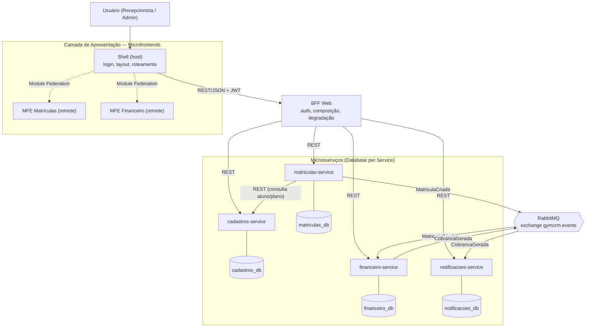
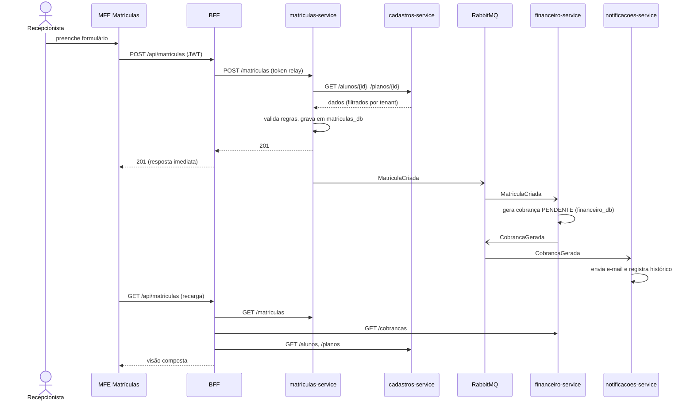

# GymCRM Cloud — Arquitetura distribuída (base para o trabalho)

Este documento resume o que foi implementado nesta etapa e **onde cada parte entra na documentação já existente** (C4 nível 4, UML, Arc42).

## 1. Visão de contêineres (atualização do C4 nível 2)

## 2. Fluxo "Criar matrícula" (atualização do diagrama de sequência)

## 3. Database per Service

| Serviço | Banco | Dono de | Como outros acessam |
|---|---|---|---|
| cadastros | `cadastros_db` | `alunos`, `planos` | REST `GET /alunos`, `/planos` |
| matrículas | `matriculas_db` | `matriculas` | REST `GET /matriculas`; evento `MatriculaCriada` |
| financeiro | `financeiro_db` | `cobrancas` | REST `GET /cobrancas`; evento `CobrancaGerada` |
| notificações | `notificacoes_db` | `notificacoes` | REST `GET /notificacoes` |

Regras: sem FK entre bancos (`matricula_id` em `cobrancas` é referência **lógica**); sem `JOIN` entre serviços — a junção acontece no BFF (API Composition) ou o dado necessário viaja no evento (`alunoEmail` e `valor` em `MatriculaCriada`, evitando chamada síncrona do financeiro).
Multi-tenancy continua por coluna `tenant_id` (schema compartilhado *dentro* de cada banco).

## 4. Contratos de eventos

| Evento | Produtor | Consumidores | Campos |
|---|---|---|---|
| `MatriculaCriada` | matrículas | financeiro | `tenantId, matriculaId, alunoId, alunoEmail, planoId, valor, occurredAt` |
| `CobrancaGerada` | financeiro | notificações | `tenantId, cobrancaId, matriculaId, alunoEmail, valor, vencimento, occurredAt` |

Topologia: *topic exchange* `gymcrm.events`, routing key = nome do evento; fila durável por consumidor (`<servico>.<Evento>`); falha no handler → `nack` sem requeue → DLQ `gymcrm.dead-letter`.
Cada consumidor **declara localmente** o contrato que lê (como no código original) — acoplamento só pelo schema do evento.

## 5. Mapeamento para os artefatos do trabalho

| Artefato | O que atualizar |
|---|---|
| **C4 – Contêineres** | Substituir "API Backend" única pelos 4 serviços, BFF, shell/remotes, RabbitMQ e 4 bancos (diagrama da seção 1). |
| **C4 – Componentes** | Cada serviço mantém a anatomia de slice já documentada (`GymCRM_Diagramas_Backend.md`); acrescentar o adapter `Http*Reader` (matrículas) e `RabbitMqEventBus`. |
| **UML – Sequência** | Seção 2 (substitui o fluxo síncrono/em memória). |
| **Arc42 §3 Contexto** | Sem mudança de fronteira externa. |
| **Arc42 §4 Estratégia da solução** | Microfrontends, BFF, microsserviços, DB per service, EDA. |
| **Arc42 §5 Blocos de construção** | Níveis 1–2 = seção 1; nível 3 = anatomia de slice. |
| **Arc42 §6 Runtime** | Cenário "Criar matrícula" (seção 2) e cenário de falha: financeiro fora do ar → BFF degrada (`degradado:["financeiro"]`); e-mail falha → DLQ. |
| **Arc42 §7 Implantação** | `docker-compose.yml` (1 container por serviço + 4 Postgres + RabbitMQ + nginx do shell). |
| **Arc42 §8 Conceitos transversais** | Multi-tenancy (JWT → `TenantContext`), propagação de identidade, tratamento de erros (`DomainError`→HTTP, upstream→503/502), idempotência/outbox (implementados). |
| **Arc42 §9 Decisões** | ADR-M1…M6 (README). |
| **Arc42 §10 Qualidade** | Resiliência (timeouts, degradação, DLQ), isolamento de falhas por microfrontend (`RemoteBoundary`), testabilidade (testes de arquitetura por serviço). |
| **Arc42 §11 Riscos/débitos** | Relay do outbox single-instance, rate limit em memória, segredo JWT compartilhado, observabilidade parcial. |

## 6. Estilos adicionados nesta etapa

- **API Gateway** (`api-gateway/`): porta de entrada única; JWT na borda, rate limit, CORS, request-id, timeouts. **ADR-M7**: gateway próprio e mínimo para o trabalho ser executável localmente; em produção, Azure API Management.
- **Serverless** (`serverless/azure-functions/`): **ADR-M8** — o envio de e-mail é um efeito colateral sem estado, orientado a evento e com carga variável → Azure Function HTTP + Azure Communication Services. O `notificacoes-service` continua dono do histórico e da idempotência (adapter `AzureFunctionEmailSender` atrás do port `INotificationSender`).
- **EDA endurecida**: **ADR-M9** — Transactional Outbox + Idempotent Receiver + retry/backoff + DLQ + publisher confirms; `correlationId` ponta a ponta; monitor operacional (`/eventos`, `/api/eventos`, `frontend/mfe-eventos`).

Trechos para o Arc42: §4 (estilos), §5 (gateway e function como blocos), §6 (cenários: e-mail falha 2x e conclui; duplicata ignorada; broker fora do ar com outbox acumulando), §7 (APIM + Function App + Container Apps), §8 (idempotência, outbox, correlação), §9 (ADR-M7…M9), §11 (limitações do README).

## 7. Ainda é evolução futura
Observabilidade completa (OpenTelemetry), schema registry/versionamento de eventos, circuit breaker, IdP real (Entra ID), jobs agendados (Timer trigger) para inadimplência/renovação.
