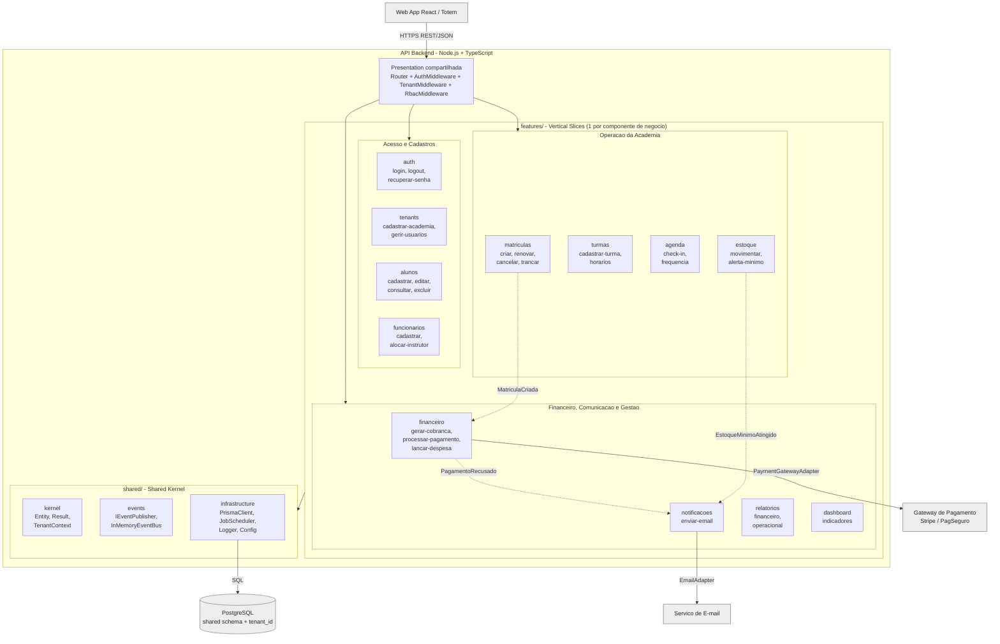
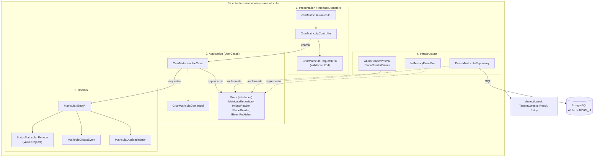
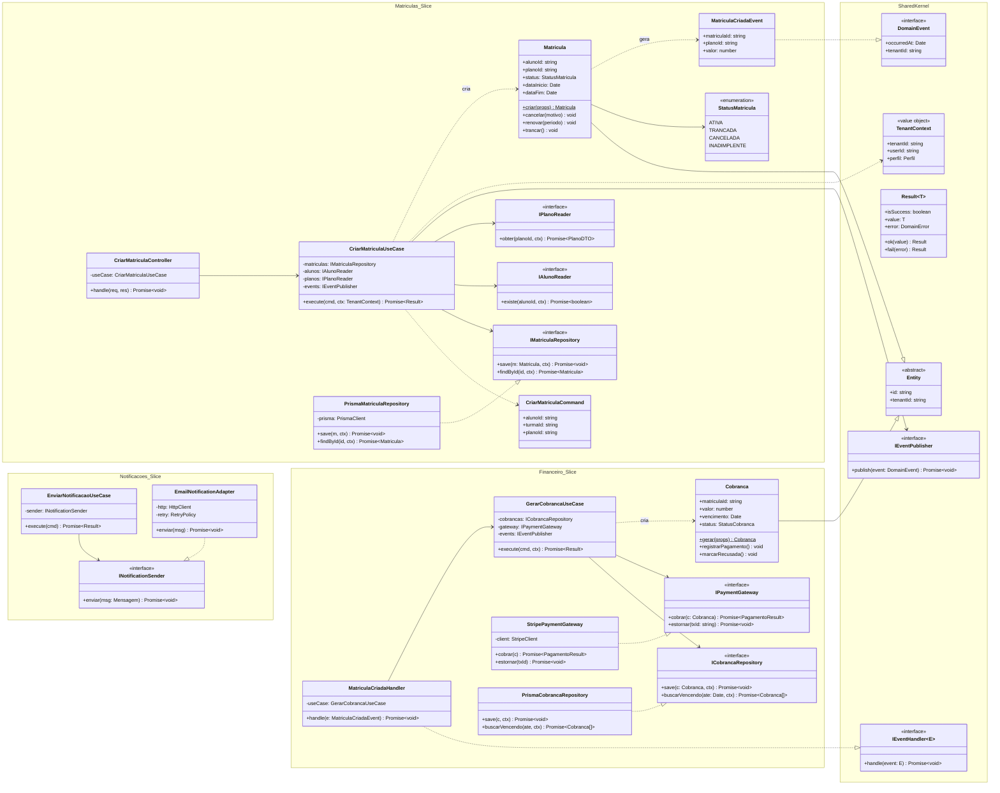

# GymCRM - Diagramas do Backend (Vertical Slice + Clean Architecture + SOLID)

## Componentes - Visão por Vertical Slices

## Componentes - Anatomia de um Slice (Clean Architecture)

## Classes - Shared Kernel, Matrículas, Financeiro e Notificações

